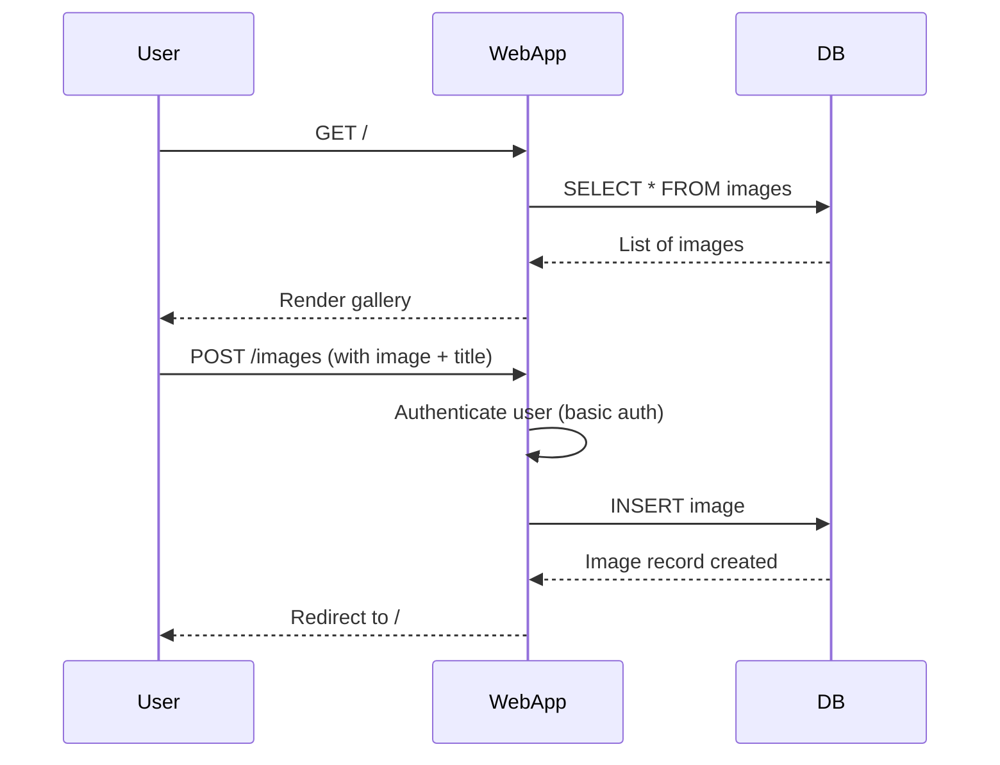
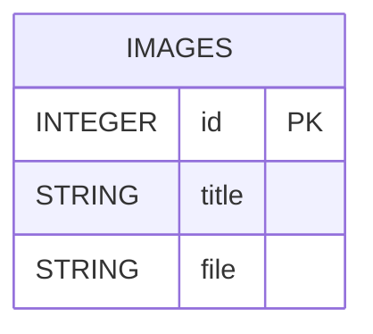
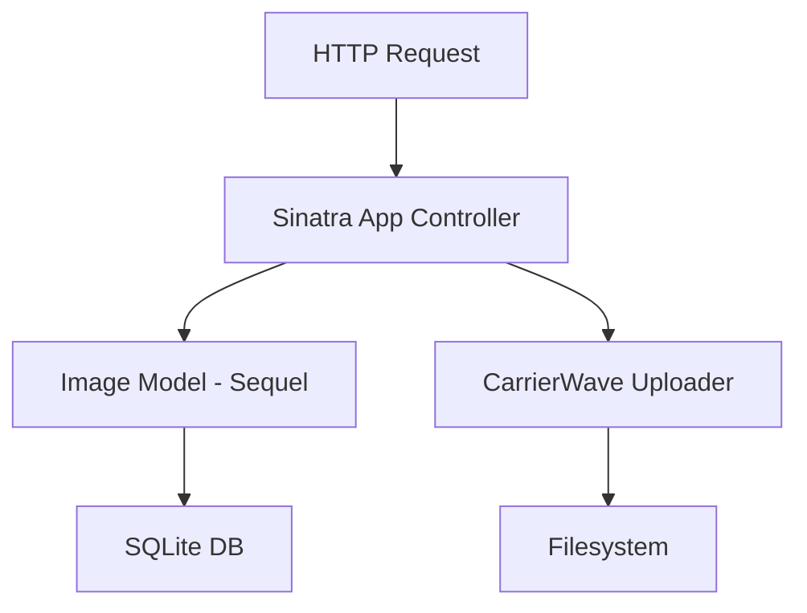

# Image Gallery

A simple web-based image gallery application built with Sinatra, supporting image upload, display, and basic authentication. Images are stored in a SQLite database and managed with Sequel ORM and CarrierWave for uploads.

---

## Table of Contents

- [Features](#features)
- [Tech Stack](#tech-stack)
- [Architecture Diagrams](#architecture-diagrams)
  - [Sequence Diagram](#sequence-diagram)
  - [Entity Relationship Diagram (ERD)](#entity-relationship-diagram-erd)
  - [Service Layer Diagram](#service-layer-diagram)
- [API Endpoints](#api-endpoints)
- [How to Run](#how-to-run)

---

## Features

- View all uploaded images in a responsive gallery.
- Upload new images with a title (authentication required).
- View images at full size in a lightbox.
- Basic HTTP authentication for image uploads.
- Uses Bootstrap for styling and Lightbox for image preview.

---

## Tech Stack

- **Backend:** Ruby, [Sinatra](http://sinatrarb.com/), [Sequel ORM](https://sequel.jeremyevans.net/)
- **Database:** SQLite (file-based, simple for development)
- **Uploads:** [CarrierWave](https://github.com/carrierwaveuploader/carrierwave) with [carrierwave-sequel](https://github.com/carrierwaveuploader/carrierwave-sequel)
- **Frontend:** Bootstrap, Haml, [Lightbox](https://lokeshdhakar.com/projects/lightbox2/) (with jQuery)

---

## Architecture Diagrams

### Sequence Diagram



---

### Entity Relationship Diagram (ERD)



- Only one table: `images`
  - `id`: Primary Key (integer)
  - `title`: Image title
  - `file`: Path to the uploaded file

---

### Service Layer Diagram



---

## API Endpoints

| Method | Path          | Description                     | Auth Required | Input Params     |
|--------|---------------|---------------------------------|---------------|------------------|
| GET    | `/`           | Show all images                 | No            | -                |
| GET    | `/images/:id` | Show a specific image           | No            | -                |
| POST   | `/images`     | Upload a new image              | Yes (admin/admin) | `image[file]`, `image[title]` |

### Details

- **GET `/`**
  - Returns: HTML page listing all images.
- **GET `/images/:id`**
  - Returns: HTML page showing a single image in detail.
- **POST `/images`**
  - Requires HTTP Basic Auth (`admin`/`admin` by default).
  - Accepts multipart form-data with `image[file]` and `image[title]`.
  - Saves image and redirects to `/`.

---

## How to Run

### Requirements

- Ruby (2.5+ recommended)
- Bundler (`gem install bundler`)

### Setup

```sh
git clone https://github.com/KuSeMi/image-galery.git
cd image-galery
bundle install
```

### Database Setup

Run the migration to create the database schema:

```sh
ruby lib/migrate.rb
```

### Start the Application

```sh
rackup
```

By default, the server runs at [http://localhost:9292](http://localhost:9292).

### Uploading Images

- Visit `/`
- Click "Upload new image" (requires HTTP Basic Auth: `admin` / `admin`)
- Upload your image and enter a title.


## License

MIT

---

## Notes

- To change the default admin password, modify the `authorized?` helper in `app.rb`.
- Uploaded files are stored in the `public/uploads` directory by default.
